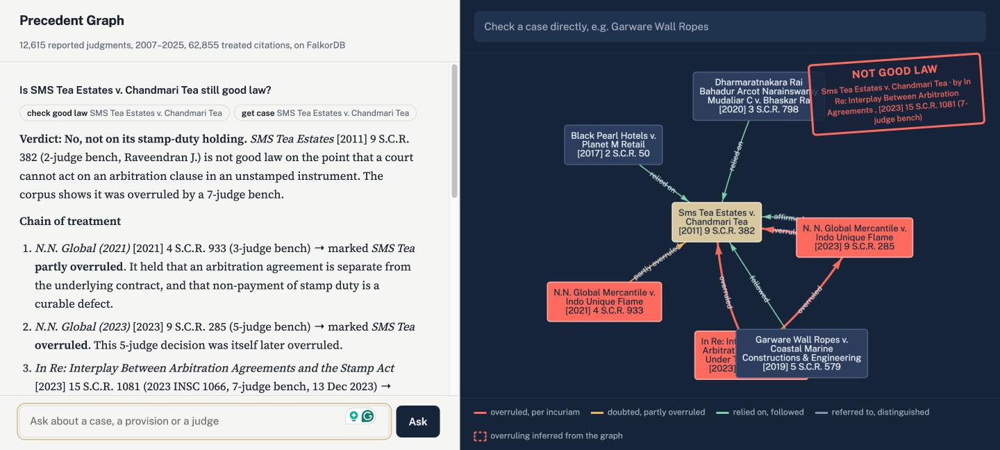
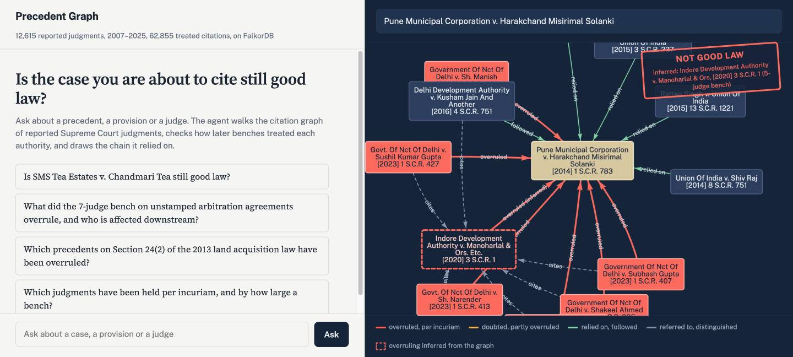
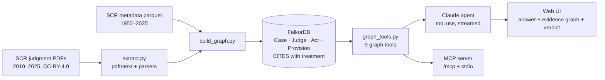

# Precedent Graph

**Is the case you are about to cite still good law?**

Precedent Graph is an AI research agent for Indian Supreme Court case law. Its context layer is a **FalkorDB citation graph** of 12,615 reported judgments (2010–2025) and 62,855 citations. Each citation carries the court editors' own label for how the precedent was treated.

The agent doesn't guess whether a precedent stands. It walks the graph and works out:
- which later benches overruled, doubted or relied on the precedent;
- whether the judgment that overruled it was itself overruled;
- whether the precedent rests on authority that was later overruled.

Every answer comes with the evidence chain drawn on screen.

| | |
|---|---|
| **Live app** | https://precedents.cyruslogic.net |
| **MCP endpoint** | `https://precedents.cyruslogic.net/mcp/`  run `claude mcp add --transport http precedents https://precedents.cyruslogic.net/mcp/` |
| **Demo video** | _link to be added_ |
| **Cypher and graph algorithms** | [docs/CYPHER.md](docs/CYPHER.md) |
| **Hackathon** | Graph Hacks: Context for AI Agents (WeMakeDevs × FalkorDB). **Track 01** (primary) and Track 03 |



*Above: the agent's answer, with the tool calls it made, the evidence graph it reasoned over and the verdict.*



*Above: the direct case check, with no LLM involved. Six 2-judge benches mark* Pune Municipal Corporation *as overruled, but none of them had the bench strength to do it. The graph infers the actual overruling judgment, the 5-judge* Indore Development Authority *(dashed outline), even though Indore's own editorial label says only "referred to".*

### Try these

- **Agent:** "Is SMS Tea Estates v. Chandmari Tea still good law?"
- **Case check, no LLM:** *Garware Wall Ropes*. It was overruled by a 5-judge bench that a 7-judge bench later overruled, so the verdict is a caution, not "not good law".
- **Case check, no LLM:** *Pune Municipal Corporation Harakchand*. The overruling judgment is inferred from the graph.
- **Agent:** "What did the 7-judge bench on unstamped arbitration agreements overrule, and who is affected downstream?"
- **MCP, from Claude Code:** "Use precedents to check whether Vidya Drolia is still good law."

## What it does

| Question | How the graph answers it |
|---|---|
| Is *X* still good law? | Finds incoming `CITES` edges with negative treatment (overruled, per incuriam, not good law, doubted). Compares bench strength and dates to decide which judgment actually overruled it. |
| Was the overruling itself overruled? | Second hop: if the judgment that overruled *X* was later overruled by an equal or larger bench, the verdict becomes a caution, because *X* may be restored. Example: *Garware Wall Ropes* was overruled by 5-judge *N.N. Global*, and 7-judge *In Re: Interplay* then overruled *N.N. Global*. |
| Who overruled it? | Editorial labels record a precedent's *status*: a 2-judge bench may mark a 3-judge ruling "overruled" because a larger bench overruled it earlier. When no noting judgment has the bench strength to have done it, the agent **infers the overruling authority**: a later, larger bench that the noting judgments all cite, and which itself cites the target. |
| Does my precedent rest on bad law? | Multi-hop upstream search: *X* → relied on → *Y* ← overruled by *Z*, up to 2 hops. Flags whether *Y* was overruled before *X* was decided (a per-incuriam risk) or after. |
| Who still relies on it? | Downstream positive citations dated after the first negative treatment. |
| Leading cases on s. 482 CrPC? | `Provision` nodes ranked by citation PageRank, with counts of negative treatment. |
| How are two lines of authority connected? | `algo.SPpaths` over `CITES`, showing the treatment on each hop. |
| What did Justice X's benches overrule? | `Judge -ON_BENCH-> Case -CITES{NEGATIVE}-> Case` |

**An example the graph gets right that the labels alone miss:** *Pune Municipal Corporation v. Harakchand Solanki* [2014] 1 S.C.R. 783 (3-judge bench) is marked "overruled" by six 2-judge benches in 2023. None of them could have overruled it. All six cite *Indore Development Authority v. Manoharlal* [2020] 3 S.C.R. 1, a 5-judge bench that also cites *Pune Municipal*. Indore's own table only says "referred to", yet the agent infers Indore as the overruling authority and shows why.

## Architecture



**Data.** The [Indian Supreme Court Judgments](https://registry.opendata.aws/indian-supreme-court-judgments/) open dataset (Dattam Labs, CC-BY-4.0).
- Metadata for every reported judgment, 1950–2025.
- Full-text PDFs for 2010–2025: 12,783 judgments.

Each Supreme Court Reports (SCR) judgment carries an editorial list of the cases it cites, with the treatment of each one. Three layouts appear over the years and all three are parsed:
- 2010–16: an OCR'd headnote list
- 2017–23: the "Case Law Reference" table
- 2023–25: "List of Citations" / "Case Law Cited"

Because these treatments are editorial, the citation edges are not LLM guesses.

**Graph (FalkorDB).** Loaded in compact form so it fits the FalkorDB Cloud free tier (about 75 MB):

```
(:Case {key, scr, insc, short, date, year, bench_size, reported, held, keywords, pagerank, community})
(:Judge {id, name, aliases})-[:ON_BENCH|AUTHORED]->(:Case)
(:Case)-[:UNDER]->(:Act {name})
(:Case)-[:INTERPRETS]->(:Provision {id, ref})-[:OF]->(:Act)
(:Case)-[:CITES {treatment, polarity, paras, context}]->(:Case)
```

| | |
|---|---|
| Cases | 29,011 (12,615 fully parsed, plus cited authorities back to 1950) |
| Treated citations | 62,855. 2,402 SCC/AIR citations were resolved to SCR judgments by fuzzy-matching both party names within the citation year. |
| Judges / Acts / Provisions | 142 / 829 / 1,843 |
| Graph features used | Cypher multi-hop patterns, `algo.pageRank` (authority score), `algo.SPpaths` (connection paths), `algo.labelPropagation` (doctrine communities), full-text indexes over cases and provisions, read-only queries (`GRAPH.RO_QUERY`) for agent safety |

**Queries.** Every Cypher query and graph algorithm the product depends on is listed, with explanations, in [docs/CYPHER.md](docs/CYPHER.md).

**Agent.** Claude with 10 tools: `search_cases`, `get_case`, `check_good_law`, `citing_cases`, `connection_path`, `cases_on_provision`, `landmark_cases`, `judge_profile`, `treatment_search` (for example, every judgment held *per incuriam*), and `run_cypher` (read-only and schema-aware; its results are drawn as a graph too). The UI streams tool calls as they happen. It draws exactly the nodes and edges the agent reasoned over, and stamps the verdict.

**MCP.** The same tools are served over MCP, so any MCP client can use the graph as its context layer. All tools are annotated read-only.

- **Claude Code / Claude Desktop:** see the commands below.
- **ChatGPT** (plans with Developer Mode): go to Settings → Apps → Advanced settings and turn on **Developer mode**. Click **Create app**, enter the URL `https://precedents.cyruslogic.net/mcp/` and choose **No authentication**. Then in a chat, click **+**, choose Developer mode and select the app.


```bash
claude mcp add --transport http precedents https://<your-deployment>/mcp/
# or locally over stdio
python -m app.mcp_server
```

## Run it

```bash
python3 -m venv .venv && source .venv/bin/activate
pip install -r requirements.txt
cp .env.example .env            # add ANTHROPIC_API_KEY
uvicorn app.server:app --port 8000      # then open http://localhost:8000
```

**On Linux you don't need a database to try it.** With `FALKORDB_HOST` unset, the app starts an **embedded FalkorDB** (the `falkordblite` wheel) and loads the bundled graph dump (`data/precedents_full.json.xz`) on first boot, which takes about a minute.

**On macOS or Windows,** run FalkorDB in Docker and set `FALKORDB_HOST=localhost` in `.env`:

```bash
docker run -d -p 6379:6379 -p 3000:3000 falkordb/falkordb:latest   # port 3000 is the FalkorDB Browser
``` When `FALKORDB_HOST` points at FalkorDB Cloud:
- the app loads the dump if the graph is missing;
- it falls back to embedded mode if the cloud instance is unreachable.

The direct case check (the search box above the graph) works without an API key.

### Rebuild the graph from source data

```bash
pip install -r requirements-pipeline.txt
# 1. download metadata + English judgment tars from the public S3 bucket (see pipeline/README section below)
# 2. extract: PDFs -> text -> structured JSONL  (needs poppler's pdftotext)
bash pipeline/run_extract.sh 2010 2011 ... 2025
# 3. build into FalkorDB (local or cloud via FALKORDB_* env vars) and save a portable dump
python pipeline/build_graph.py --meta work/meta_all.parquet --extracted work/extracted \
       --reset --compact --save-dump data/precedents_compact.json.gz
# or load an existing dump into any FalkorDB (e.g. FalkorDB Cloud)
python pipeline/build_graph.py --from-dump data/precedents_compact.json.gz --reset
```

Downloads:

```bash
for y in $(seq 1950 2025); do curl -sf --create-dirs -o data/metadata/$y.parquet \
  "https://indian-supreme-court-judgments.s3.amazonaws.com/metadata/parquet/year=$y/metadata.parquet"; done
for y in $(seq 2010 2025); do curl -f -o data/tar/english-$y.tar \
  "https://indian-supreme-court-judgments.s3.amazonaws.com/data/tar/year=$y/english/english.tar"; done
```

### Deploy

- **Your own server (recommended):** see [DEPLOY.md](DEPLOY.md). It runs one script on Ubuntu 24.04 with Docker Compose, FalkorDB, the app and Caddy, which provides automatic HTTPS. The full graph loads from `data/precedents_full.json.xz`.
- **Render plus FalkorDB Cloud:** `render.yaml` is included. Set `ANTHROPIC_API_KEY` and the `FALKORDB_*` variables. The free cloud tier (100 MB) needs the compact dump: set `GRAPH_DUMP=data/precedents_compact.json.gz`.

## Limitations

- Treatments come from SCR editorial tables. If a citing judgment isn't in the 2010–2025 corpus, its treatment isn't in the graph. "No negative treatment found" means none was found in this corpus. It is not a certificate of good law.
- Bench strength is known only for judgments in the corpus. For older targets, the "who overruled it" reasoning falls back to dates and labels.
- Parsing is regex-based over PDF text. Older OCR'd volumes are noisier: some citations resolve only to stub nodes named by their SCC citation.
- A few judges appear under two OCR spellings (for example "J S Khehar" and "J D S Khehar"), which splits their profile. Spelling variants seen fewer than three times are dropped.
- The agent reads editorial treatment labels, not the full reasoning. When a case is partly overruled, or overruled on one point only, the answer says so only if the label or the stored paragraph shows it. Read the cited paragraph.
- This is a research aid, not legal advice.

## Data attribution

Judgments and metadata: *Indian Supreme Court Judgments*, Dattam Labs, AWS Open Data Registry, [CC-BY-4.0](https://creativecommons.org/licenses/by/4.0/). Source: Supreme Court of India, Digital SCR (scr.sci.gov.in).
